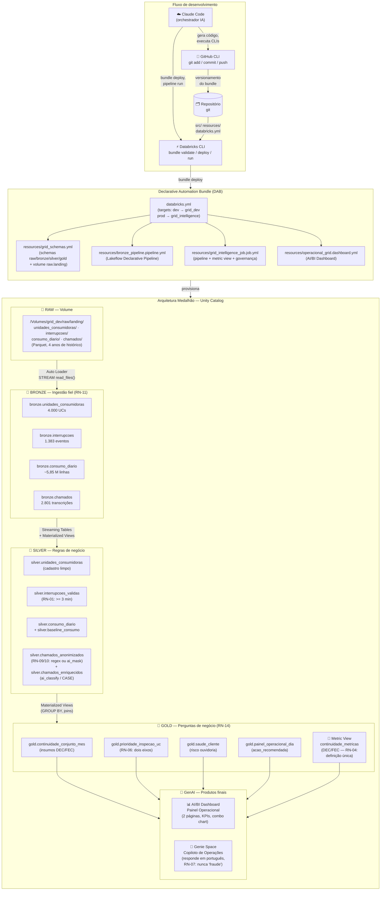

# Grid Intelligence

Plataforma de dados e IA para a distribuidora fictícia **Luz do Vale Distribuidora S.A.**, construída no Databricks com **Declarative Automation Bundles**, **Lakeflow Declarative Pipelines** e **Genie Agents**.

O projeto é desenvolvido inteiramente pelo **Claude Code** a partir de uma sequência de 8 prompts — cada um entrega uma feature completa, com deploy e resultado visível no workspace.

> Curso completo: [suajornadadedados.com.br/projeto-completo-databricks](https://lp.suajornadadedados.com.br/projeto-completo-databricks.html)

---

## Visão geral da arquitetura



---

## Contexto de negócio

A **Luz do Vale Distribuidora S.A.** opera sob regulação da ANEEL e enfrenta três dores simultâneas:

| Dor | Impacto financeiro |
|-----|--------------------|
| **Continuidade do fornecimento** (DEC/FEC) | > R$ 1,1 bilhão em compensações pagas em 2024 |
| **Perdas Não Técnicas** (furto/fraude/erro) | ~R$ 11,5 bilhões em 2025 |
| **Atendimento ao cliente** | Milhares de ligações com alertas antecipados ignorados |

### Glossário obrigatório

| Termo | Definição |
|-------|-----------|
| **UC** | Unidade Consumidora — ponto de entrega de energia. ≠ cliente |
| **Conjunto** | Subdivisão geográfica da área de concessão; unidade do regulador |
| **DEC** | Duração Equivalente de Interrupção por UC (horas sem fornecimento) |
| **FEC** | Frequência Equivalente de Interrupção por UC (nº de interrupções) |
| **PNT** | Perdas Não Técnicas |
| **Prioridade de inspeção** | Classificação de visita técnica — nunca acusação |

---

## Pré-requisitos e instalação

### 1. GitHub CLI

```bash
# macOS
brew install gh

# Windows (winget)
winget install --id GitHub.cli

# Autenticar
gh auth login
```

### 2. Databricks CLI

```bash
# macOS / Linux
curl -fsSL https://raw.githubusercontent.com/databricks/setup-cli/main/install.sh | sh

# Windows (winget)
winget install Databricks.DatabricksCLI

# Verificar versão (mínimo 1.0.0)
databricks --version
```

### 3. Claude Code

```bash
# npm (requer Node.js >= 18)
npm install -g @anthropic/claude-code

# Verificar
claude --version
```

### 4. Configurar o perfil Databricks

```bash
# Cria o perfil grid_intelligence no ~/.databrickscfg
databricks configure --profile grid_intelligence
# → informe: host (https://seu-workspace.cloud.databricks.com)
# → token ou OAuth

# Testar autenticação
databricks auth profiles
databricks current-user me --profile grid_intelligence
```

### 5. Clonar o repositório e instalar dependências do bundle

```bash
git clone https://github.com/eudesfh/LakehouseDatabricks.git
cd LakehouseDatabricks/grid_intelligence
```

---

## Sobre o Declarative Automation Bundle (DAB)

Um **Bundle** é o mecanismo de IaC (Infrastructure as Code) do Databricks. Ele empacota **recursos, pipelines, jobs e dashboards** num único repositório Git e os implanta via CLI em qualquer ambiente — mantendo isolamento entre dev e prod sem duplicar código.

```
grid_intelligence/
├── databricks.yml              ← manifesto principal: targets, variáveis
├── resources/
│   ├── grid_schemas.yml        ← schemas raw/bronze/silver/gold + volume
│   ├── bronze_pipeline.pipeline.yml   ← Lakeflow Declarative Pipeline
│   ├── grid_intelligence_job.job.yml  ← job que orquestra tudo
│   └── operacional_grid.dashboard.yml ← AI/BI Dashboard
└── src/
    ├── pipelines/grid_intelligence/transformations/
    │   ├── 01_bronze.sql
    │   ├── 10_silver_cadastro.sql
    │   ├── 11_silver_interrupcoes.sql
    │   ├── 12_silver_consumo.sql
    │   ├── 13_silver_chamados.sql
    │   ├── 20_gold_continuidade.sql
    │   ├── 21_gold_prioridade_inspecao.sql
    │   ├── 22_gold_saude_cliente.sql
    │   └── 23_gold_painel_operacional.sql
    ├── sql/
    │   ├── metric_view_continuidade.sql
    │   └── governanca_dado_pessoal.sql
    ├── dashboards/operacional_grid.json
    └── genie/
        ├── copiloto_operacoes.json   ← definição do Genie Space (${catalogo})
        └── apply.ps1                 ← script de deploy do Space
```

### Isolamento de ambientes via catálogo

O mesmo código SQL roda em dev e prod sem modificação. O catálogo é a única diferença:

| Ambiente | Catálogo | Schemas |
|----------|----------|---------|
| `dev`    | `grid_dev` | `raw`, `bronze`, `silver`, `gold` |
| `prod`   | `grid_intelligence` | `raw`, `bronze`, `silver`, `gold` |

A flag `experimental.skip_name_prefix_for_schema: true` impede que o modo desenvolvimento prefi xe os schemas com o nome do usuário.

### Ciclo de deploy (três comandos)

```bash
# 1. Validar sintaxe e variáveis (roda local, sem workspace)
databricks bundle validate --profile grid_intelligence

# 2. Empacotar e provisionar recursos no workspace
databricks bundle deploy -t dev --profile grid_intelligence

# 3. Verificar o estado atual no workspace
databricks bundle summary -t dev --profile grid_intelligence
```

---

## Como criar os catálogos (pré-requisito do bundle)

O bundle não cria catálogos — eles são recursos de conta. Crie por SQL:

```bash
# Criar catálogo de dev
databricks experimental aitools tools query --profile grid_intelligence \
  "CREATE CATALOG IF NOT EXISTS grid_dev COMMENT 'Catalogo de desenvolvimento'"

# Criar catálogo de prod
databricks experimental aitools tools query --profile grid_intelligence \
  "CREATE CATALOG IF NOT EXISTS grid_intelligence COMMENT 'Catalogo de producao'"

# Conceder permissões ao seu usuário
databricks grants update CATALOG grid_dev \
  --json '{"changes":[{"principal":"SEU-EMAIL","add":["ALL_PRIVILEGES"]}]}' \
  --profile grid_intelligence
```

> ⚠️ **Recomeçar do zero (destrutivo):**
> ```bash
> databricks experimental aitools tools query --profile grid_intelligence \
>   "DROP CATALOG IF EXISTS grid_dev CASCADE"
> ```
> `CASCADE` remove **todos** os schemas, tabelas, volumes e arquivos — sem confirmação.

---

## Como subir os dados para o volume

Após o primeiro deploy (`bundle deploy -t dev`), faça upload dos Parquets:

```bash
# Uma pasta por base, com o arquivo .parquet dentro
databricks fs cp -r <PASTA_LOCAL>/unidades_consumidoras \
  dbfs:/Volumes/grid_dev/raw/landing/unidades_consumidoras \
  --overwrite --profile grid_intelligence

databricks fs cp -r <PASTA_LOCAL>/interrupcoes \
  dbfs:/Volumes/grid_dev/raw/landing/interrupcoes \
  --overwrite --profile grid_intelligence

databricks fs cp -r <PASTA_LOCAL>/consumo_diario \
  dbfs:/Volumes/grid_dev/raw/landing/consumo_diario \
  --overwrite --profile grid_intelligence

databricks fs cp -r <PASTA_LOCAL>/chamados \
  dbfs:/Volumes/grid_dev/raw/landing/chamados \
  --overwrite --profile grid_intelligence
```

> O prefixo `dbfs:` é **obrigatório** mesmo em caminhos de Unity Catalog Volume.

---

## Como o Claude Code orquestra a construção

O Claude Code lê os prompts em `prompts/` e constrói **toda a plataforma** — arquivos SQL, YAMLs de bundle, JSON do dashboard e do Genie Space — sem você escrever uma linha de código.

**Fluxo de trabalho:**

```
1. Abra o Claude Code na raiz do repositório
   $ claude

2. Cole o prompt inteiro (do arquivo .md correspondente)
   > [conteúdo de prompts/00-setup.md]

3. Claude gera os arquivos, valida e faz deploy
   → bundle validate → bundle deploy → pipeline run

4. Você revisa o resultado no workspace Databricks

5. Cole o próximo prompt
   > [conteúdo de prompts/01-bronze.md]

6. Repita até o prompt 06
```

> **Regra de ouro:** execute um prompt de cada vez, na ordem. Cada prompt assume o anterior concluído e indica explicitamente o que **não** deve ser feito ainda.

---

## A sequência de 8 prompts

| # | Arquivo | Entrega | Resultado visível |
|---|---------|---------|-------------------|
| 00 | [`prompts/00-setup.md`](prompts/00-setup.md) | Contexto, regras de negócio, schemas e volume | Catálogo com as 4 camadas + dados no volume |
| 01 | [`prompts/01-bronze.md`](prompts/01-bronze.md) | Ingestão fiel (Auto Loader) | 4 tabelas bronze + painel de qualidade |
| 02 | [`prompts/02-silver-numeros.md`](prompts/02-silver-numeros.md) | RN-01, dedup e baseline | Quanto a regra dos 3 min descartou |
| 03‑A | `prompts/03-silver-texto-ia.md` | Anonimização + IA (`ai_mask`, `ai_classify`) | Transcrição antes e depois do mascaramento |
| 03‑B | [`prompts/03-silver-texto-regex.md`](prompts/03-silver-texto-regex.md) | Ou: mesmo resultado com regex + `CASE` | As mesmas colunas, em segundos |
| 04 | [`prompts/04-gold.md`](prompts/04-gold.md) | 4 tabelas gold + metric view DEC/FEC | DEC e FEC por conjunto, de uma definição só |
| 05 | [`prompts/05-dashboard.md`](prompts/05-dashboard.md) | AI/BI Dashboard (2 páginas) | Painel operacional publicado |
| 06 | [`prompts/06-agente.md`](prompts/06-agente.md) | Genie Space em português | Copiloto respondendo sobre Campinas |
| 07 | `prompts/07-relatorio-e-demonstracao.md` | Relatório executivo + provas | Uma página para diretoria + 8 queries |

### O prompt 03 tem duas versões — escolha uma

| | 03‑A, com IA | 03‑B, com regex |
|--|-------------|----------------|
| Tempo | dezenas de minutos | segundos |
| Qualidade | entende o texto | casa o padrão |
| Reprodutibilidade | varia entre execuções | idêntica sempre |

As duas produzem **as mesmas colunas** e cumprem RN-09 e RN-10. Os prompts 04 em diante funcionam igual, sem saber qual rota foi escolhida.

---

## Regras de negócio do projeto

| # | Regra | Resumo |
|---|-------|--------|
| RN-01 | Limiar de duração | Só interrupções **≥ 3 minutos** entram no DEC/FEC |
| RN-04 | Definição única | DEC e FEC têm **uma única fonte** — a metric view |
| RN-06 | Dois eixos | UC candidata à inspeção: queda vs. si mesma **E** vizinhança estável |
| RN-07 | Sem acusação | Saída é **prioridade de inspeção** (alta/média/baixa), jamais "fraude" |
| RN-09 | Mascarar antes | Dado pessoal mascarado **antes** de qualquer análise |
| RN-10 | Acesso restrito | Original preservado com column mask por grupo |
| RN-11 | Bronze fiel | Ingestão **não filtra, não corrige, não aplica regra** |
| RN-12 | Rastreabilidade | Todo registro carrega `arquivo_origem` e `ingerido_bronze_em` |
| RN-13 | Gold only | O agente conversacional acessa **apenas a camada gold** |
| RN-14 | COMMENT na gold | Tabelas gold e metric view têm descrição em linguagem de negócio |

---

## Referência de comandos CLI

```bash
# --- Bundle ---
databricks bundle validate --profile grid_intelligence
databricks bundle deploy -t dev --profile grid_intelligence
databricks bundle deploy -t prod --profile grid_intelligence
databricks bundle run grid_intelligence_job -t dev --profile grid_intelligence
databricks bundle summary -t dev --profile grid_intelligence
databricks bundle destroy -t dev --profile grid_intelligence   # ⚠️ destrutivo

# --- Pipeline ---
databricks pipelines list --profile grid_intelligence
databricks pipelines start-update <PIPELINE_ID> --profile grid_intelligence

# --- Jobs ---
databricks jobs list --profile grid_intelligence
databricks jobs get-run <RUN_ID> --profile grid_intelligence

# --- Dados ---
databricks fs ls dbfs:/Volumes/grid_dev/raw/landing --profile grid_intelligence
databricks experimental aitools tools query --profile grid_intelligence "SELECT ..."

# --- Warehouses ---
databricks warehouses list --profile grid_intelligence

# --- Genie Space (apply.ps1) ---
# Criar
.\src\genie\apply.ps1 -Catalog grid_dev
# Atualizar
.\src\genie\apply.ps1 -Catalog grid_dev -SpaceId 01f1dd060c1315cea5474ffd2ddb5616

# --- Genie — testar via API de conversação ---
databricks genie start-conversation --no-wait <SPACE_ID> "Sua pergunta" \
  --profile grid_intelligence -o json
databricks genie get-message <SPACE_ID> <CONV_ID> <MSG_ID> \
  --profile grid_intelligence -o json

# --- Git ---
gh auth login
git add . && git commit -m "mensagem" && git push
```

---

## Datasets sintéticos

| Base | Grão | Volume |
|------|------|--------|
| `unidades_consumidoras` | por ponto de entrega | 4.000 UCs |
| `interrupcoes` | por evento de rede | 1.383 eventos |
| `consumo_diario` | por UC por dia | ~5,85 milhões (4 anos) |
| `chamados` | por ligação com transcrição | 2.801 registros |

O dataset tem **4 anos de histórico**, crescimento de **30% ao ano** e sazonalidade de verão. Ele carrega **defeitos propositais** — consumo nulo/negativo, interrupções abaixo de 3 minutos, cadastros incompletos — para as camadas de qualidade terem o que fazer.

---

## Recursos implantados (grid_dev)

| Recurso | ID / Nome |
|---------|-----------|
| Pipeline Lakeflow | `grid_intelligence_etl` |
| Job | `grid_intelligence_job` |
| Metric View | `grid_dev.gold.continuidade_metricas` |
| AI/BI Dashboard | `operacional_grid` |
| Genie Space | `01f1dd060c1315cea5474ffd2ddb5616` |

---

## Licença

Projeto educacional — uso livre para fins de estudo e demonstração.
